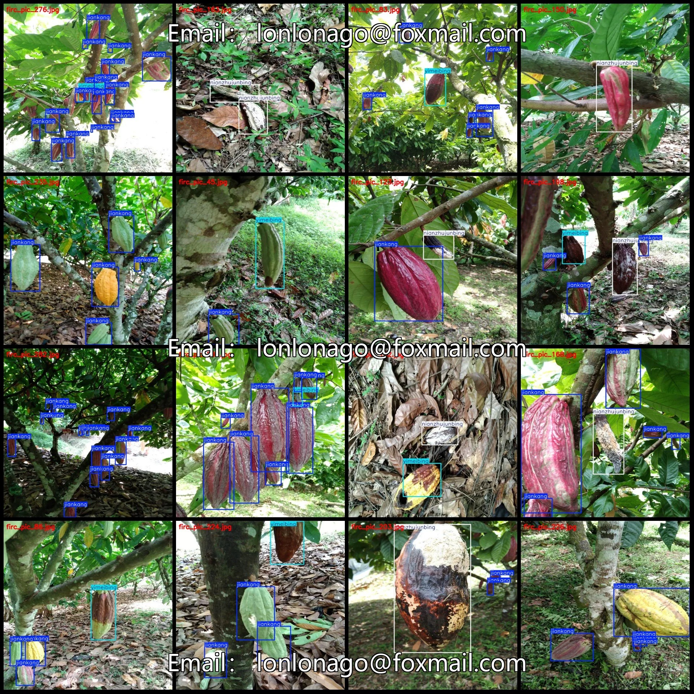
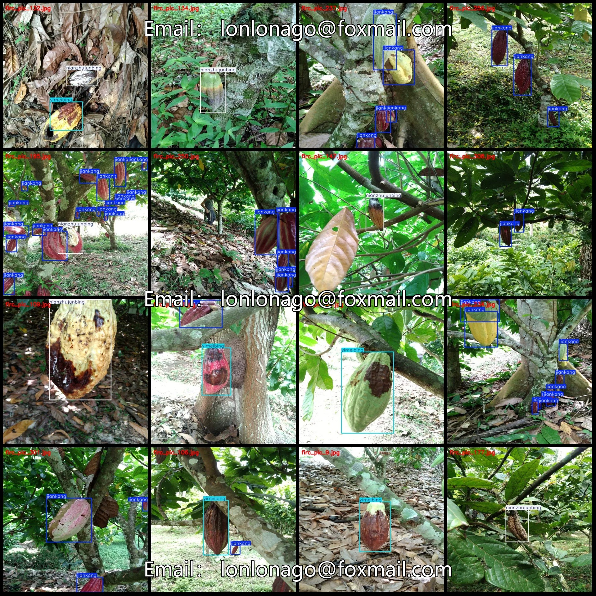
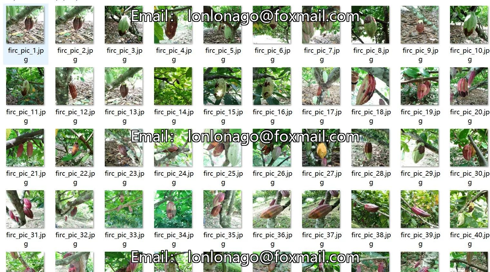
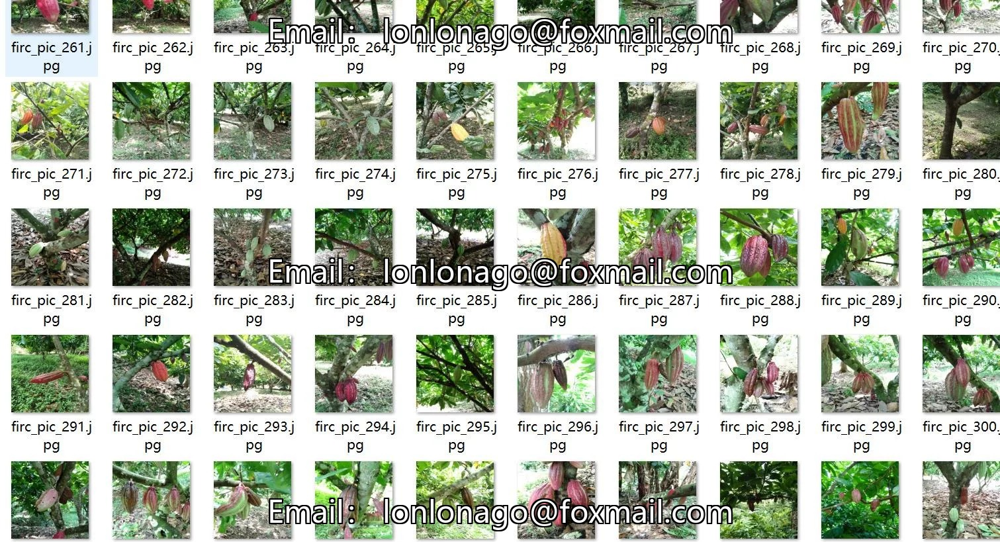
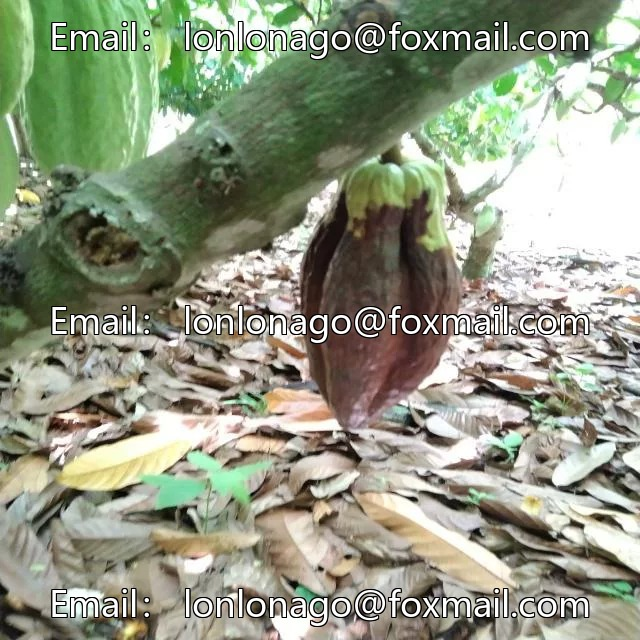
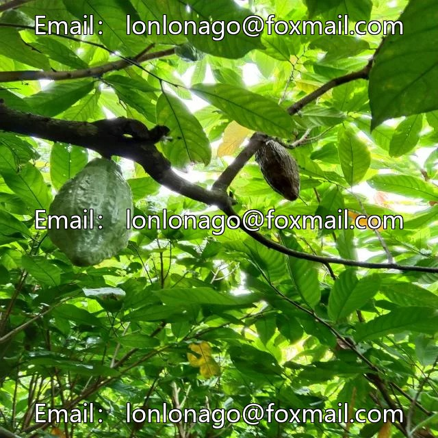
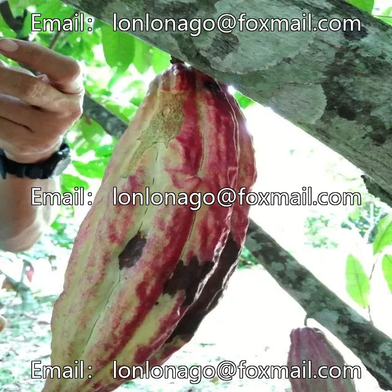

# Cocoa fruit disease detection dataset VOC+YOLO format with 312 images in 3 categories

## Body

Cocoa fruit disease detection dataset VOC+YOLO format with 312 images in 3 categories
Tips: Due to the dataset's replicability, please confirm compliance before purchasing.
Dataset format: Pascal VOC format + YOLO format (txt file without split path, only containing jpg images and corresponding VOC format xml files and yolo format txt files)
Number of images (number of jpg files): 312
Number of annotations (number of xml files): 312
Number of annotations (number of txt files): 312
Number of annotation categories: 3

Label category names (Note that the order of categories in the YOLO format does not correspond to this, but is based on the classes.txt file in the labels folder): ["jiankang", "nianzhujunbing", "yimeibing"]
Healthy category: ["Health", "Candida Albicans", "Pneumocystis jirovecii pneumonia"]
Number of boxes and the number of images occupied by each category
Health Frames = 1219, Pictures Taken = 257
Nianzhujunbing Frames = 145, Pictures Taken = 123
yimeibing box count = 227, occupying image count = 164
Total frames: 1591
Image resolution: 640x640

Using labeling tool: labelImg
Labeling rules: Draw a rectangle around the category.
Important note: The dataset does not have separate training, validation, and test sets; you need to partition them yourself.
Special statement: This dataset does not guarantee the accuracy of the trained models or weight files.

## Images

## Payment

Here is a pay link on Stripe ( https://buy.stripe.com/3cs8yP7sY87d0vu9AB ). Please contact me lonlonago@foxmail.com after funding $89, and I will send you a complete data files , thank you!

